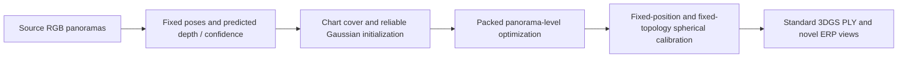

# Π-GS / PIPANOGS

**Panorama-Aware 3D Gaussian Splatting from Sparse Omnidirectional Images**

Uzair Shah, Giovanni Pintore, Hadeel Abed, Wala Elsharif, Muhammad Tukur, Mahmood Alzubaidi, Alberto Jaspe-Villanueva, Jens Schneider, Enrico Gobbetti, and Marco Agus.

Π-GS treats overlapping perspective charts from one panorama as parameterizations of one physical observation. It aggregates Gaussian reliability and densification evidence at panorama level, reuses shared-center appearance evaluation in packed camera-batched rendering, and calibrates the resulting standard 3DGS scene for direct equirectangular rendering.



**Release status:** this release uses the original panorama-aggregated **screen-space densification statistic**. It does not implement an angular projection-Jacobian conversion. The reliability EMA write-back correction is retained. A room-0 GPU run completed, and CPU regressions cover preparation, aggregation, state updates, and optimizer budgets. The complete twelve-scene manuscript table has not been independently reproduced. See [paper/code correspondence](docs/PAPER_CODE_CORRESPONDENCE.md).

## Installation

Linux, Python 3.10, a CUDA-capable NVIDIA GPU, a CUDA 12.6 toolkit (`nvcc`), a compatible driver, and a C++ compiler are required for training. The paper reports timings on an RTX 4090 (24 GB). The environment recipe uses versions observed in the source workspace; it is not a fully resolved dependency lock.

```bash
git clone https://github.com/Uzshah/PIPANOGS.git
cd PIPANOGS
conda env create -f environment.yml
conda activate pipanogs
bash tools/setup.sh
```

The source snapshots needed to compile Graphdeco utilities, simple-knn, the Graphdeco rasterizer, fused SSIM, and the SPaGS spherical backend are included under `third_party/`. No submodule checkout is required. Build extensions locally; compiled binaries are not distributed. `gsplat==1.5.3` is installed through pip. The first gsplat render may compile additional CUDA kernels.

## Data

Obtain Replica360 RGB panoramas and masks under their original dataset terms. Obtain source-only HYSS/FRED predictions separately; this repository starts at the fixed-pose/predicted-depth interface. It does not contain model weights or run HYSS pose/depth prediction. See [the input contract](docs/DATA.md) for formats, pose conventions, depth units, and the required source-only preprocessing protocol.

```text
data/Replica360/room_0_rand/
  0000_rgb_pano.jpg ... 0009_rgb_pano.jpg
  0000_mask_pano.png ... 0009_mask_pano.png

data/hyss/room_0_rand/
  panorama/iter_00/
    sfm_output/sfm_poses.npz
    fred_depths/
      0000.png
      0000_weight.png
      ...                         # training panoramas only
```

Replica ground-truth `.dpt` files are **not required or read** by the release preparation pipeline. Held-out RGB is exported into evaluation charts but excluded from the training COLMAP camera list, initialization, and calibration. Source-only provenance of externally supplied predictions must be established when generating those inputs.

## Run one scene

Run from the repository root. Use absolute paths or paths relative to your current directory.

```bash
python tools/run.py \
  --config configs/replica360.json \
  --data-root data/Replica360 \
  --hyss-root data/hyss \
  --work-root outputs/replica360 \
  --scenes room_0_rand
```

This prepares 80 overlapping 512×512 charts per panorama, initializes a reliable Gaussian scene, performs 29,000 optimizer updates with four co-centered charts per update, performs 1,000 fixed-position spherical calibration updates, and evaluates the two held-out panoramas at 1024×512. The perspective stage provides 116,000 supervised chart exposures. Learning-rate and densification schedules use rendered-chart units.

These are the **available fair-30k runner settings**, not a verified configuration for the exact manuscript table. An alternative historical 7,500 + 1,000 update configuration is provided as `configs/chart_budget_30k.json`; it uses 30,000 perspective-chart exposures. Keep the two budgets distinct in reports.

Inspect the commands without creating outputs:

```bash
python tools/run.py --data-root data/Replica360 --hyss-root data/hyss \
  --scenes room_0_rand --dry-run
```

Run individual stages with `--stages prepare`, `--stages train`, `--stages calibrate`, or `--stages evaluate`. After preparation, `--stages graphdeco` trains an optional conventional 30k control from the same initialization (see [benchmark scope](docs/REPRODUCIBILITY.md)). Run `--stages perspective-evaluate` to render and fuse perspective charts from the uncalibrated model. This optional evaluator reports its historical metrics; use the common image-pair evaluator for comparisons across methods.

For all twelve scenes and multiple seeds, omit `--scenes` and add `--seeds 0 1 2`. Start with seed 0 for the primary configuration. `configs/smoke.json` uses 8 + 2 updates and the full preparation size; it checks execution, not reconstruction quality.

Completed stages have JSON markers; failures stop the run and leave their log for diagnosis. A different configuration requires a new output directory. Preparation is shared across seeds. Inputs must remain immutable within an output directory. Interrupted preparation may leave incomplete directories; use a fresh output directory rather than treating partial output as complete. Optimizer-state checkpoint resume is not implemented.

## Outputs and evaluation

```text
outputs/replica360/
  config.json
  splits/<scene>.json
  charts/<scene>/
  prepared/<scene>/
  maps/<scene>/
  models/seed_0/<scene>/
    perspective/point_cloud/iteration_29000/point_cloud.ply
    calibrated/point_cloud/iteration_1000/point_cloud.ply
    calibrated/test/spherical_cuda_1000/*_{render,gt}.png
    calibrated/c6pi_spherical_cuda.json
  logs/
  runs/
```

The final PLY retains degree-3 spherical-harmonic appearance, opacity, scale, rotation, and position. Calibration changes scale, rotation, opacity, and SH coefficients; it preserves Gaussian positions, count, and topology. Gaussian count is stored count, not a per-view active count.

```bash
python tools/summarize.py --work-root outputs/replica360
```

This writes CSV and JSON summaries and reports missing scene/seed results. Complete aggregate results require every scene and requested seed; the tool refuses incomplete results by default. PSNR, SSIM, and VGG LPIPS are evaluated on full RGB ERP images using the same implementation for every method. LPIPS may download its backbone weights on first use. The existing spherical benchmark synchronizes CUDA and excludes loading; its `render_ms` uses SPaGS's benchmark path, so retain the backend mode and hardware in timing reports.

## Room-0 validation

The screen-gradient release was exercised on an RTX 4090 with 7,500 batched training updates plus 1,000 spherical calibration updates. The result was 28.535 dB PSNR, 0.8716 SSIM, and 0.1985 LPIPS with 998,846 Gaussians at 1024×512. Calibration preserved positions and Gaussian count exactly. The prepared inputs record upstream pose estimation using held-out RGB, so this is a functional validation, not a strict source-only reproduction of the paper.

## Manuscript results

The supplied manuscript reports these averages over twelve Replica360 scenes at 1024×512. These values are transcribed from the manuscript, not recomputed by this release.

| Method | PSNR ↑ | SSIM ↑ | LPIPS ↓ |
|---|---:|---:|---:|
| PFGS360-KP | 24.601 | 0.827 | 0.198 |
| SPaGS | 25.717 | 0.844 | 0.161 |
| Π-GS | **27.050** | **0.879** | **0.132** |

The available earlier result documentation reports different values. Exact checkpoint/configuration provenance for the revised manuscript table is not available in this source snapshot. [Reproducibility notes](docs/REPRODUCIBILITY.md) distinguish the executable release from unresolved numerical reproduction and baseline requirements.

## Code layout

| Directory | Purpose |
|---|---|
| `native_gs/` | Gaussian state, reliability aggregation, batched rendering, training, spherical calibration, evaluation |
| `scripts/` | Chart construction, train-only initialization, spherical supervision maps, common metrics |
| `tools/` | Environment checks, experiment runner, result summaries, source-integrity checks |
| `configs/` | Explicit scene splits, initialization counts, seeds, and budgets |
| `tests/` | CPU regressions and synthetic end-to-end preparation |
| `third_party/` | Source snapshots and their retained license notices |
| `provenance/` | Original source hashes, release integrity manifest, and release changes |

Historical C0–C5 LOD experiments and unrelated datasets are omitted from the main method release. Internal C6/PI/PISR filenames are retained to make correspondence with the research implementation clear.

## Validation

```bash
python -m pytest -q
python tools/verify_release.py
python tools/check_environment.py
```

The first two commands run without a GPU (the tests require CPU PyTorch, NumPy, Pillow, OpenCV, and pytest). The environment check requires the compiled extensions and a working CUDA device. See [validation](docs/VALIDATION.md) for what was actually checked locally.

## Citation and attribution

[CITATION.cff](CITATION.cff) describes the supplied manuscript; no acceptance status, DOI, or proceedings record is assumed. The perspective engine uses gsplat and Graphdeco's Gaussian scene utilities. Spherical calibration and direct rendering use SPaGS's existing backend. Camera classes come from NeRFICG; the initialization consumes externally generated HYSS/FRED predictions.

Third-party licenses remain in their respective directories; Graphdeco components carry non-commercial research/evaluation terms. See [THIRD_PARTY.md](THIRD_PARTY.md). To copy this folder into the existing GitHub repository while preserving its README commit, follow [publishing instructions](docs/PUBLISHING.md).

No new blanket license has been assigned to the authors' original code; that release decision remains with the authors. Dataset and weight redistribution rights are separate.
