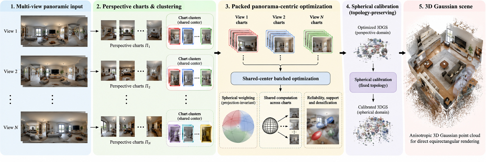

# Π-GS: Panorama-Aware 3D Gaussian Splatting

This implementation uses panorama-aggregated screen-space densification, packed chart rendering, and fixed-position spherical calibration.



## Install

Requires Linux, an NVIDIA GPU, CUDA 12.6 with `nvcc`, GCC/G++ compatible with CUDA, and Conda.

```bash
git clone https://github.com/Uzshah/PIPANOGS.git
cd PIPANOGS
conda env create -f environment.yml
conda activate pipanogs
export CC=/usr/bin/gcc
export CXX=/usr/bin/g++
bash tools/setup.sh
```

Use a compatible compiler; GCC/G++ 11 was used for the room-0 run. Keep these compiler variables set when running training because gsplat may compile kernels on first use.

## Prepare inputs

Supply Replica360 RGB panoramas and masks, plus fixed poses and HYSS/FRED predicted depth/confidence. HYSS/FRED inference and pretrained weights are external inputs. Replica ground-truth `.dpt` files are not needed.

```text
data/Replica360/<scene>/
  0000_rgb_pano.jpg ... 0009_rgb_pano.jpg
  0000_mask_pano.png ... 0009_mask_pano.png

data/hyss/<scene>/panorama/iter_00/
  sfm_output/sfm_poses.npz
  fred_depths/
    0000.png
    0000_weight.png
    ...
```

The pose archive contains `<pano>_R` (3×3 camera-to-world rotation) and `<pano>_t` (3-vector camera center) for every panorama. Predicted depth PNGs are uint16, decoded as meters = value / 4000. Confidence PNGs are uint16, decoded as value / 65535. Masks use nonzero pixels for valid regions. Poses and depth must share a coordinate system and metric scale.

Training IDs: `0000 0001 0002 0005 0006 0008 0009`. Validation: `0004`. Test: `0003 0007`. Generate training poses/depth/confidence from training images only; supply held-out evaluation poses separately. Depth/confidence files are required only for training panoramas.

## Run room 0

```bash
python tools/run.py \
  --config configs/replica360.json \
  --data-root data/Replica360 \
  --hyss-root data/hyss \
  --work-root outputs/replica360 \
  --scenes room_0_rand
```

This performs preparation, 29,000 training updates with four charts per batch, 1,000 spherical calibration updates, and evaluation at 1024×512. All configurations use screen-space densification.

For the shorter 7,500 + 1,000 update run:

```bash
python tools/run.py \
  --config configs/chart_budget_30k.json \
  --data-root data/Replica360 \
  --hyss-root data/hyss \
  --work-root outputs/room0_7500 \
  --scenes room_0_rand
```

Omit `--scenes` to run all twelve scenes. Add `--seeds 0 1 2` for multiple seeds. Select individual stages with `--stages prepare`, `--stages train`, `--stages calibrate`, or `--stages evaluate`. Add `--dry-run` to inspect commands without executing them.

Completed stages are skipped. Use a new output directory when changing the configuration or after interrupted preparation. Optimizer-state resume is not supported.

## Outputs

```text
outputs/replica360/
  prepared/<scene>/
  maps/<scene>/
  models/seed_0/<scene>/
    perspective/point_cloud/iteration_29000/point_cloud.ply
    calibrated/point_cloud/iteration_1000/point_cloud.ply
    calibrated/test/spherical_cuda_1000/*_render.png
    calibrated/c6pi_spherical_cuda.json
  logs/
```

The calibrated PLY is the final model. Evaluation JSON contains PSNR, SSIM, LPIPS, Gaussian count, and rendering time. LPIPS may download its backbone weights on first use.

```bash
python tools/summarize.py --work-root outputs/replica360
```

Use `--allow-partial` when only some scenes are complete, and `--seeds 0 1 2` when summarizing multiple seeds.

Bundled dependencies retain their original licenses, including Graphdeco's non-commercial research/evaluation terms.
